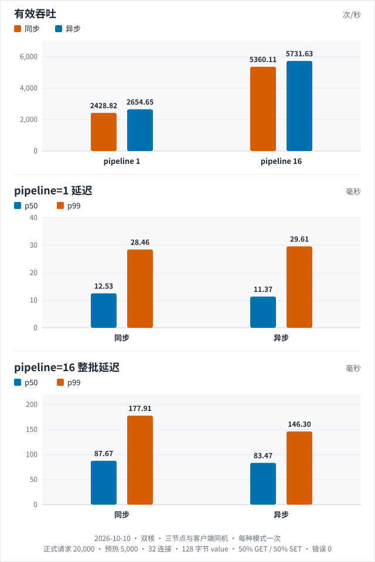

[English](README.md) | **简体中文**

# Raft-KV

[](https://github.com/Die4U23/Raft-KV/actions/workflows/portable.yml)
[](https://github.com/Die4U23/Raft-KV/actions/workflows/linux-cluster.yml)

一个用 C++17 实现的三节点 Raft KV 存储学习项目，把 Muduo 网络接入、Raft 共识、RocksDB 持久化、有界并发与真实故障验证放进同一条请求链路。

项目实践长文：[从三节点存储到故障验证与性能优化](docs/raft-kv-project-practice.md)。

## 核心能力

- **Raft 写路径**：Pre-Vote、Leader 选举、CheckQuorum、日志复制、多数派提交、顺序状态机应用。
- **ReadIndex 线性一致读**：开启后，用读请求之后发出的探针取得多数派确认，等待本地应用位置追上后读取。可选租约读在时钟假设成立时复用近期多数派证据；两个开关默认都关闭。
- **持久化语义**：Raft 日志和硬状态同步落盘；KV 与 `lastApplied` 在同一 RocksDB WriteBatch 中提交。
- **快照与重试身份**：分块 `InstallSnapshot` 帮助落后副本追赶；持久化安装意图支持跨两个数据库的中断恢复。`IDEMP` 为每个客户端保存最近一次请求及回复。
- **有界服务**：限制连接数、输入/输出缓冲、写队列、提案数及字节数，过载时拒绝而不是无限积压。
- **批量与异步应用**：未满写批默认收集 1 ms，满批无需等待该定时器即可排队执行。已提交 KV 批次交给串行工作线程，完成通知回到所有者线程。
- **RESP 协议接入**：每连接按 FIFO 顺序回复，支持 pipeline、二进制 value 和有界解析。半包等待新字节，不再反复调度同一批未完成输入。
- **可追溯验证**：分区、Leader 崩溃/重启、过载和对照实验都保留报告、节点日志、源码/二进制指纹及独立核验脚本。

## 架构

```text
客户端（RESP）→ CommandBuffer → 每连接命令队列
                                  │
                ┌─────────────────┴──────────────────┐
                ▼                                    ▼
         SET / DEL / IDEMP                          GET
                │                                    │
             RaftNode                       本地读 / ReadIndex / 租约
                │                                    │
     RaftLog + PeerManager                           │
        │              │                             │
    RocksDB         其他节点                         │
                       │                             │
                  多数派提交                         │
                       ▼                             ▼
                  串行 KV 应用 ──────────────► KVStateMachine
                       │                             │
                       └──────────► RocksDB ◄─────────┘
```

写请求在多数派提交、状态机应用完成后回复。Leader 上的线性一致 GET 需要 ReadIndex 确认（或显式开启且有效的租约），并等待所需应用位置；Follower 会重定向。默认 GET 直接读本地状态，可能读到旧值。详细时序、线程归属与回调生命周期见[并发处理说明](docs/concurrency.md)。

## 当前验证

**2026-10-27** 对代码版本 [`30d29ef`](https://github.com/Die4U23/Raft-KV/commit/30d29ef174e304fc81ea28ceae50596e6175f858) 做了本地 Linux 验证，使用 Debian Docker 环境和真实 Muduo、Protobuf、RocksDB：

| 检查 | 结果 | 范围 |
| --- | --- | --- |
| 完整构建与 CTest | **20/20** | 18 个可移植目标、真实 peer 传输、TCP 顺序与半包回归 |
| Python 辅助测试 | **80/80** | 编排、客户端和 PASS/FAIL/SKIP 判定，不是共识正确性证明 |
| 三节点冒烟 | **PASS** | 读写、Leader 崩溃、重启、收敛与健康接口 |
| ReadIndex 集成脚本 | **4 passed、0 failed、0 skipped** | 重启 Follower 拒读、写后读、并发读和 Leader 替换 |
| 缺少服务二进制 | **退出码 2** | 未完整执行不能报告成功 |

上述四场景 ReadIndex 脚本不模拟持续少数派分区。Linux CI 另行运行 `cluster_linearizable.py`、网络分区、写入重启和过载场景。徽章链接到实时 CI 状态；这份本地验证记录不代表所有 CI 场景均已通过。命令与边界见 [tests/README.md](tests/README.md)。

“可移植”指不链接真实服务依赖的 C++ 目标。Python 全套目前有一项 Linux 挂载路径测试在 Windows 失败（同轮验证为 79/80）；完整 Python 套件和服务测试应在 Linux 运行。

## 历史故障与性能记录

以下归档属于各自记录的二进制和环境。其中 CTest 5/5、7/7 是历史数量，性能数字没有在当前代码上重新测量。

| 场景 | 结果 | 证据 |
| --- | --- | --- |
| Ubuntu 26.04 三进程冒烟 | 构建、CTest 5/5、冒烟 10/10 | [全量构建记录](docs/benchmarks/linux-fresh-validation.md) |
| 短时 TCP 分区 | 隔离旧 Leader、多数派继续写入、恢复后副本收敛 | [分区验证](docs/benchmarks/partition-validation.md) |
| 持续写入中崩溃/重启 | 1,704 个已确认键在两次恢复后的三副本上保留 | [恢复验证](docs/benchmarks/write-restart-validation.md) |
| 过载与 60 秒观察 | 连接准入、`BUSY`、恢复清零和资源阈值均通过 | [过载验证](docs/benchmarks/overload-validation.md) |

2026-10-10 在这台双核机器上跑了一次对照：三个节点和客户端同机，32 连接，128 字节 value，50% GET / 50% SET，预热 5,000 次，再正式测量 20,000 次。`group_commit_ms=1`，`snapshot_threshold=1024`。每种模式各一次。四个单元错误都是 0。测量窗口里整机空闲大约 1% 到 2%。

`pipeline=1` 的延迟是单次请求往返：

| 模式 | 有效吞吐 | p50 | p99 |
| --- | ---: | ---: | ---: |
| 同步应用 | 2,428.82 ops/s | 12.53 ms | 28.46 ms |
| 串行异步应用 | 2,654.65 ops/s | 11.37 ms | 29.61 ms |

`pipeline=16` 的延迟是 16 条命令的整批延迟：

| 模式 | 有效吞吐 | 整批 p50 | 整批 p99 |
| --- | ---: | ---: | ---: |
| 同步应用 | 5,360.11 ops/s | 87.67 ms | 177.91 ms |
| 串行异步应用 | 5,731.63 ops/s | 83.47 ms | 146.30 ms |

[](docs/benchmarks/async-apply-compare-2026-10-10.json)

这些是这台机器、这份负载上的一次测量。每种模式只跑了一次，这次的差距不是稳定差异。`pipeline=16` 的异步单元里，观察到的最大 `apply_lag` 是 32；其余三个单元是 0。更早的四轮归档仍在[性能基线](docs/benchmarks/ubuntu-2cpu-abba.md)。这次的报告是 [async-apply-compare-2026-10-10.json](docs/benchmarks/async-apply-compare-2026-10-10.json)。

## 快速开始

### 1. 构建

在 Linux 的仓库根目录执行。先按 [Ubuntu 系统依赖说明](docs/linux-build.md#1-安装系统依赖)安装软件包；构建脚本不会代装依赖。随后使用记录源码、依赖与二进制身份的流程：

```bash
python3 scripts/build_linux.py --jobs 2 --smoke
```

成功后服务位于 `build-linux-repro/server/raft_kv_server`。系统依赖、Muduo 准备方式和报告结构见 [Ubuntu 构建说明](docs/linux-build.md)。

不依赖 Muduo/RocksDB 实库的可移植 C++ 回归：

```bash
cmake -S . -B build-portable \
  -DRAFTKV_BUILD_SERVER=OFF -DBUILD_TESTING=ON -DCMAKE_BUILD_TYPE=Debug
cmake --build build-portable --parallel 2
ctest --test-dir build-portable --output-on-failure
```

Linux 上用 `python3 -m unittest discover -s tests -p '*_tests.py'` 运行 Python 辅助测试。安装 Ninja 后，也可用 `bash scripts/run_new_tests.sh` 合并运行可移植构建和辅助测试，不运行真实集群。可用 `ctest --test-dir build-portable -N` 列出已注册的 C++ 测试。

### 2. 一条命令演示

用已经编好的 Linux 服务起三个进程：选出 Leader，写入并在三个节点读到，Follower 上的 `SET` 返回 `MOVED`，杀掉 Leader 后新 Leader 仍能读到旧数据并继续写，旧进程用原来的目录重启后三个节点一致。这是同一台机器上的三个进程。

```bash
python3 scripts/demo.py \
  --binary build-linux-repro/server/raft_kv_server
```

加上 `--hold` 时，演示结束后进程先留着，可以用 `redis-cli -p <客户端端口>` 再试，按回车才退出。

### 3. 手动启动三节点

在三个终端的仓库根目录分别运行以下代码，将 `NODE_ID` 依次设为 **0**、**1**、**2**。默认 peer 列表是本机的 Raft 端口 9080–9082；每个节点使用配对且独立的 KV / Raft 目录：

```bash
NODE_ID=0  # 另两个终端分别改成 1、2。
BIN="$PWD/build-linux-repro/server/raft_kv_server"
mkdir -p "/tmp/raft-kv-demo-$NODE_ID"
"$BIN" --node_id="$NODE_ID" \
  --client_port="$((8080 + NODE_ID))" --raft_port="$((9080 + NODE_ID))" \
  --db_path="/tmp/raft-kv-demo-$NODE_ID/kv" \
  --raft_log_path="/tmp/raft-kv-demo-$NODE_ID/raft" \
  --linearizable_reads=true
```

分别用 `redis-cli -p 8080 INFO`（以及 8081、8082）查找 `state:leader` 和 `leader_id`。0 号节点不一定是 Leader。多机时，需要给所有节点配置一致的 `--peers=id:IPv4:raft_port,...`。

同一台机器上也可以用运行镜像起三个容器。每个容器有自己的数据卷，KV 和 Raft 日志都在该卷的 `/data` 下。`GET /health` 只说明这个进程还在服务，不说明它是 Leader，也不说明多数派还在。

```bash
docker compose -f docker/compose.yaml up --build
curl -fsS localhost:9090/health
```

**读模式**（三个开关默认均为 `false`）：

| 配置 | GET 行为 |
| --- | --- |
| 默认 | 任意节点读取本地已应用状态，可能返回旧值 |
| `--leader_only_reads=true` | Follower 重定向；Leader 仍直接读本地，没有多数派读屏障 |
| `--linearizable_reads=true` | Follower 重定向；Leader 确认 ReadIndex 屏障并等待应用位置 |
| 再加 `--lease_reads=true` | Leader 租约有效时可省去探针，否则退回 ReadIndex |

租约新鲜度按关联成功的 AppendEntries RPC 的原始发送时间计算，不按 ACK 到达或重试时间刷新。它依赖单调选举时钟以可比较的速率推进；无法满足该假设时保持关闭。

| 其他参数 | 默认值 | 作用 |
| --- | --- | --- |
| `--group_commit_ms` | `1` | 未满写批的收集窗口，范围 0–10 ms |
| `--async_apply` | `true` | 已提交 KV 在串行 worker 应用；Raft 日志仍同步写入 |
| `--max_clients` | `1024` | 最大并发客户端连接数 |
| `--snapshot_threshold` | `1024` | 自动快照尝试之间的已应用条目间隔，`0` 表示关闭 |
| `--metrics_port` | `0` | 非零时启用 `/metrics` 和 `/health`，不能与客户端、Raft 端口相同 |

### 4. 读写

把端口改为通过 `INFO` 找到的**当前 Leader** 端口；需要时另行安装 `redis-cli`：

```bash
LEADER_PORT=8080  # 改成实际 Leader 的客户端端口。
redis-cli -p "$LEADER_PORT" SET user:1 alice
redis-cli -p "$LEADER_PORT" GET user:1
redis-cli -p "$LEADER_PORT" DEL user:1
redis-cli -p "$LEADER_PORT" IDEMP demo-client 1 SET user:2 bob
```

向 Follower 写入会返回项目自定义的 `-ERR MOVED <leader_id>`；它不是 Redis Cluster 的完整重定向协议。

## 客户端命令

| 命令 | 语义 |
| --- | --- |
| `PING` | 返回 `PONG` |
| `SET key value` | 通过 Raft 提交和状态机应用后返回 `OK` |
| `GET key` | 默认任意节点读本地状态机；`--linearizable_reads=true` 时 Leader 走 ReadIndex，另启用且租约有效时可本地确认；此模式下 Follower 返回 `MOVED` |
| `DEL key` | 通过 Raft 删除，返回 `0` 或 `1` |
| `IDEMP client-id request-id SET key value` / `IDEMP client-id request-id DEL key` | 保存每个客户端最近一次请求及回复；重放该 id 返回原回复，更旧的 id 返回 stale |
| `SELECT namespace` | 为当前 TCP 连接选择逻辑命名空间 |
| `INFO` | 查看角色、任期、Leader、提交/应用位置和过载指标。`--metrics_port` 非 0 时，同一组数字也可从 `GET /metrics` 抓取 |

`SELECT` 只在当前连接上生效，分别执行的 `redis-cli` 进程不会共享命名空间状态。

使用稳定的 client id（1–128 字节），以及从 1 开始递增、无前导零的十进制 request id。`IDEMP` 写入结果不确定时，以相同身份和命令重试；普通 `SET` / `DEL` 重试不去重。

## 验证层级

- **可移植 C++ 回归（18 个目标）**：生产协议与队列、Raft 边界、快照、存储批量、异步执行器、组批和重连策略；存储与网络替身不证明真实磁盘持久性。
- **Python 辅助测试**：构建流程、客户端模式、性能对照与故障编排的可测部分。
- **Linux 真实服务（20 个 CTest 目标）**：可移植目标加真实 peer 传输、TCP 顺序与半包检查；冒烟与故障注入脚本另行执行。
- **证据核验**：`docs/benchmarks/verify_*.py` 对归档、哈希、报告与节点日志做交叉检查。

完整命令和每层能够/不能证明的内容见 [tests/README.md](tests/README.md)。

## 当前边界

- 集群是固定成员的单 Raft 组，没有动态成员变更和多分片。
- 自动快照的 **payload 上限为 32 MiB**。状态超限时跳过压缩，增加 `snapshot_oversize_skips` 并保留日志，让服务继续工作。阈值是尝试间隔，不是日志保留量的硬上限；日志仍可能持续增长。见[超大快照处理](docs/dev/oversized-automatic-snapshots.md)。
- 快照安装涉及独立的 KV、Raft 数据库，用持久化意图在中断后重放恢复，不是跨数据库原子事务，也不是物理掉电保证。见[快照安装恢复](docs/dev/snapshot-install-recovery.md)。
- 普通 `SET` / `DEL` 不去重。`IDEMP <client-id> <request-id> SET|DEL ...` 只保留该客户端最近一次请求：相同 id 返回第一次的回复，更小的 id 返回 stale。记录随快照保留，不会过期。
- 已受理但超过 1000 ms 仍未提交的写，客户端收到 `-ERR proposal timeout; outcome unknown`；日志保留，稍后仍可能提交。已经提交但应用较慢的写不会仅因这个期限失败。
- 已有验证不覆盖整机掉电、存储介质损坏、长时间压测或完整 Raft 正确性证明。

详细实现范围与验证边界见 [项目状态](docs/review-status.md)。

## 项目导航

```text
src/server/        RESP 接入、会话、组批与过载保护
src/raft/          RaftNode、PeerManager、KV 状态机与串行应用器
src/raftcore/      Raft 日志及硬状态持久化
src/storage/       RocksDB 封装和存储错误边界
src/common/        RESP、输入/命令队列、组批、指标和重连策略
src/namespace/     按连接管理的逻辑命名空间
proto/             Raft RPC 消息
tests/             可移植回归、真实集群故障测试与压测工具
docs/benchmarks/   原始证据、核验脚本和结果边界
scripts/           Linux 构建、固定 Muduo 准备流程、演示与测试入口
```

进一步阅读：[测试说明](tests/README.md) · [构建说明](docs/linux-build.md) · [压测方法](docs/benchmark.md) · [读一致性保证](docs/read-consistency.md) · [更新日志](CHANGELOG.md)

## 依赖与来源

主要依赖为 Muduo、RocksDB、Protobuf、gflags、glog 与 Boost。

项目的实现与设计参考了以下论文、资料和开源项目：

| 参考项目 | 地址 | 用途 |
|---|---|---|
| **Raft 论文** | https://raft.github.io/raft.pdf | Raft 算法权威文档 |
| **Raft 可视化** | https://raft.github.io/ | 帮助理解选举与日志复制 |
| **muduo** | https://github.com/chenshuo/muduo | 网络层 |
| **RocksDB** | https://github.com/facebook/rocksdb | 存储引擎 |
| **etcd** | https://github.com/etcd-io/etcd | 成熟 Raft 应用，思路参考 |
| **TiKV** | https://github.com/tikv/tikv | Raft + RocksDB 工业实践 |

感谢这些开源项目及其维护者提供的学习资源。可追溯的后续改造范围在[项目实践长文](docs/raft-kv-project-practice.md#项目来源许可证与改造范围)中单独列出。

## 许可证

本项目采用 [MIT License](LICENSE) 开源许可证。
